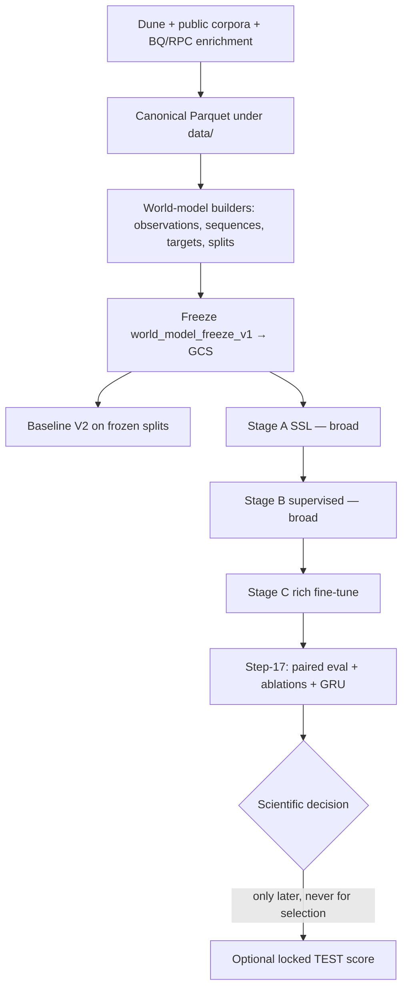

# Trencher — Project Handover

**Audience:** incoming technical lead  
**Written:** 2026-10-25  
**Repo HEAD when written:** `0e3211cc38045a187157edbd430da876fc74637c` (`main`, private: `heyronith/trencher`)  
**Working tree:** clean and fast-forwarded to `origin/main` at that SHA  

This document is the single end-to-end briefing. Read it before changing config, touching TEST, or launching GPUs.

---

## 1. One-paragraph summary

Trencher builds a **pure on-chain meme-coin world model** for Pump / PumpSwap / Solana: extract historical data → freeze an immutable multimodal corpus → train a staged multimodal Transformer (SSL → broad supervised → rich fine-tune) → evaluate scientifically against frozen baselines **without ever using the locked q85+ permanent TEST split**. As of this handover, **Stage A/B/C training is complete**, frozen checkpoints live on GCS, and **Step-17 scientific evaluation is coded and CI-green but GPU work (paired Stage-B rich inference, mask diagnostics, modality ablations, GRU control) has not been launched**.

---

## 2. Current status (as of `0e3211c`)

| Area | Status |
|------|--------|
| Local `main` vs GitHub | **Up to date** with `origin/main` |
| Open PRs | **None** |
| CI | Green on recent merges (ruff + pytest + CLI smoke) |
| Data freeze `world_model_freeze_v1` | **Frozen** (append-only; no bulk re-acquisition) |
| Candidate config | `world_model_candidate_v2.yaml` — **immutable** for this freeze |
| Config hash | `c2e7c0e51ef91df87333615f5e6cd66e0baed891fbabcb907c5f5fa55a6d8945` |
| Stage A (SSL) | Complete (lineage precedes Stage B) |
| Stage B (broad supervised) | **Complete** — checkpoint + broad permanent-val metrics |
| Stage C (rich fine-tune) | **Complete** — checkpoint + rich permanent-val preds/metrics |
| Baseline V2 | Frozen metrics under `manifests/world_model_data/baseline_v2/` |
| Step-17 package | Merged (PR #9) + metric hardening (PRs #10–#13) |
| Step-17 GPU runs | **Not started** (preflight stop-gate still says do not provision GPU) |
| Permanent TEST (q85+) | **Locked** — refuse aliases `test` / `q85_test` / `permanent_test` |

### Recent merge history (what landed after Stage C)

| PR | What |
|----|------|
| #7–#8 | Stage-C training repairs (execution mask, wallet-prior length cap) |
| #9 | Step-17 evaluation / ablation framework + provenance model |
| #10 | Multidimensional barrier metrics |
| #11 | Masked MAE broadcasting |
| #12 | Empty rich-sequence pooling |
| #13 | Tie-invariant ranking metrics |

### Stale / notable remote branches (not open PRs)

- `origin/step17/ablation-training-b7` — branched from Stage-C training SHA `b7abd1d…`, adds modality-omit + empty-sequence handling for ablation *training*. **Main already contains equivalent omit hooks + empty-sequence fixes** via PRs #9/#12. Prefer training ablations from **current `main`** unless you deliberately need bit-identity with the Stage-C producer commit. Reconcile before use; do not assume this branch is the source of truth.
- Older `fix/*` and `repair/*` remotes — already merged; safe to ignore for day-to-day work.

---

## 3. What the product is trying to do

**Question:** Given only on-chain state at observation time *T* (trades/events, bonding-curve, global market context, and optionally microstructure / ownership / wallet priors / graph), can we predict explosion / survival / barriers / returns / execution-relevant quantities better than strong tabular baselines and a simple temporal deep control?

**Hard product rules:**

1. **No social / text / image modalities.** Pure on-chain.
2. **No ID embedding tables** of wallets/mints as free parameters.
3. **Point-in-time (PIT) discipline** — no future leakage into features or labels beyond defined target horizons.
4. **Permanent TEST (top ~15% by time quantile, “q85+”) is sacred.** Never train, tune, ablate, or select a “final” model on it. Use `permanent_val_eval` on `[q70, q85)`.
5. **Freeze identity** — once `world_model_freeze_v1` and candidate v2 are locked, do not silently change splits, targets, channel counts, or optimizer schedule and still claim the same scientific lineage.

---

## 4. Repository map

```
trencher/
├── README.md                          # Dune / data CLI quickstart (narrower than this doc)
├── PROJECT_HANDOVER.md                # This file
├── pyproject.toml                     # package + extras: dev, baselines, torch
├── configs/world_model/
│   ├── world_model_candidate_v2.yaml  # ★ frozen training config
│   └── world_model_candidate_v1.yaml  # historical
├── src/trencher/
│   ├── dune/ + queries/ + schemas/    # Dune extraction → Parquet
│   ├── data/                          # public corpora + world_model dataset builders
│   ├── baselines/                     # Baseline V1/V2 trees / survival / trading metrics
│   └── world_model/                   # model, train launch, loaders, Step-17 evaluation/
├── scripts/colab/                     # GCS stage + launch_training.sh
├── manifests/                         # committed audits, freezes, Step-17 preflight
│   ├── external/                      # public dataset provenance
│   ├── feasibility/
│   └── world_model_data/              # ★ scientific paper trail
├── data/                              # gitignored local corpora
├── modal_apps/                        # Modal helpers for baselines/scale jobs
└── tests/                             # CI gate
```

### Critical manifests (start here)

| Path | Why |
|------|-----|
| `manifests/world_model_data/DATA_FREEZE.md` | Freeze policy + coverage counts |
| `manifests/world_model_data/WORLD_MODEL_DATA.md` | Layer coverage / encoder readiness |
| `manifests/world_model_data/WORLD_MODEL_COLAB_RUNBOOK_V2.md` | How to stage + train on Colab/A100 |
| `manifests/world_model_data/WORLD_MODEL_READINESS_AUDIT_V4.md` | Pre–Stage-A readiness snapshot |
| `manifests/world_model_data/baseline_v2/` | Frozen conventional baseline suite |
| `manifests/world_model_data/evaluation/STEP17_PREFLIGHT.json` | Exact Stage-B/C hashes + proposed GPU plan |
| `manifests/world_model_data/evaluation/STEP17_SCIENTIFIC_ABLATION_REPORT.md` | Placeholder answers (mostly PENDING) |

---

## 5. End-to-end pipeline



### 5.1 Data acquisition

- **Dune** (`uv run trencher dune …`): verified Pump/Solana tables → immutable daily Parquet + partition manifests (SQL hash, execution ID, checksums).
- **Public historical** (`trencher data download-historical`): HF / Zenodo corpora into `data/external/` (gitignored); provenance in `manifests/external/`.
- **World-model enrichment** (`probe-world-model-sources`, `recover-world-model-data`): microstructure, ownership/graph, global context, execution curves, etc. into `data/external/world_model/`.
- **BigQuery / RPC:** partition-pruned Token Transfers; optional `SOLANA_RPC_URL` / `HELIUS_API_KEY`. Project used in Stage-C Colab runs: `gen-lang-client-0390594165` (also referenced in ablation env). Older docs mention `trencher1` — confirm which GCP project the new lead still has ADC for.

### 5.2 Dataset / freeze contracts

Built under `src/trencher/data/world_model/` with progressive audits (`OBSERVATION_*`, `SEQUENCE_*`, `TARGET_*`, `SPLIT_*`, `TRAINING_LOADER_*`, `PIT_*`, `BROAD_SUPERVISION_*`).

Authoritative freeze:

- **Freeze ID:** `world_model_freeze_v1`
- **Loader contract:** `TRAINING_LOADER_CONTRACT_V4`
- **GCS root (production):**  
  `gs://trencher-world-model-v1-ronithworks-20260907/world_model_freeze_v1`
- **Populations:**
  - **broad** — large assignment for SSL / Stage B (~1.26M permanent-val examples in Stage-B metrics)
  - **rich** — multimodal subset (~4k mints; Stage-C permanent-val ~10k rows loaded)

**Split semantics (do not invent new ones):**

- Train: below q70  
- Val / permanent_val: `[q70, q85)`  
- **TEST / q85+:** locked forever for selection  

### 5.3 Model

Package: `src/trencher/world_model/`

- Config-driven multimodal encoders: events, curve, global, creator, (+ rich: microstructure, ownership, wallet_prior, graph).
- Gated fusion + multi-task heads (explosion, survival/TTE, barriers, returns/MFE/MAE, path, execution, …).
- Launch: `python -m trencher.world_model.launch` via `scripts/colab/launch_training.sh`.
- Durable checkpoints → `$TRENCHER_GCS_URI/runs/$TRENCHER_WM_RUN_ID/` (`latest.pt`, progress, validation artifacts).
- Scientific ablations omit modalities at **train time** via `TRENCHER_WM_OMIT_MODALITIES=graph,...` (wired in `launch.py` / `model.py`).

### 5.4 Training stages (completed)

| Stage | Phase / population | Approx intent | Frozen checkpoint identity |
|-------|--------------------|---------------|----------------------------|
| **A** | `ssl` / broad | Self-supervised representation | Precedes B; resume chain into B |
| **B** | `broad` supervised | Broad modalities + labels | See §6 |
| **C** | `rich` fine-tune from B | Add rich modalities | See §6 |

Stage-C production repairs that must remain in the lineage story:

- Execution target masking (PR #7)
- Wallet-prior max length / OOM cap (PR #8) — **Stage-C training Git SHA = `b7abd1de786bf7845b98a69752d05fb695e7d170`**

Colab ops: `manifests/world_model_data/WORLD_MODEL_COLAB_RUNBOOK_V2.md` + `scripts/colab/`. Transport note: Colab often needs `TRENCHER_GCS_TRANSPORT=python` when `gcloud` is unauthenticated.

### 5.5 Baselines

`src/trencher/baselines/` + committed V2 artifacts under `manifests/world_model_data/baseline_v2/`.  
Step-17 compares world-model permanent-val metrics to these frozen cores (explosion AUROC cells, etc.). Do not retrain baselines casually and overwrite committed hashes without a new contract version.

### 5.6 Step-17 scientific evaluation (current frontier)

CLI:

```bash
uv run python -m trencher.world_model.evaluation.step17 --help
uv run python -m trencher.world_model.evaluation.step17 lineage
uv run python -m trencher.world_model.evaluation.step17 ablation-plan
uv run python -m trencher.world_model.evaluation.step17 preflight --out manifests/world_model_data/evaluation/STEP17_PREFLIGHT.json
```

**Provenance rules (PR #9 fix — do not regress):**

- **Source-training SHAs** (immutable; describe who *trained* the checkpoints):
  - Stage B: `5f895e12779979b9140d293b42186a0e4e070ecf`
  - Stage C: `b7abd1de786bf7845b98a69752d05fb695e7d170`
- **Evaluation-runtime SHA**: discovered at execution via `git rev-parse HEAD` as `evaluation_runtime_git_sha` — **must not** be required equal to Stage-B/C training SHAs.
- Official runs **fail closed** if the git tree is dirty (`--allow-dirty` is test/dev only).
- Always record `q85_test_accessed: false`.

**Blocker for “Did Stage C beat Stage B?”**

Stage-B permanent-val metrics are **broad** (~1.26M). Stage-C is **rich** (~10k). Aggregates are **not paired**. Next GPU step is Stage-B **rich** `permanent_val_eval` inference using the frozen Stage-B checkpoint (command is already in `STEP17_PREFLIGHT.json`).

**Prespecified GPU plan (not launched):**

1. Stage-B rich permanent-val inference  
2. Inference-time modality mask diagnostics on Stage C (prioritization only — not scientific ablations)  
3. Retrain four rich ablations from Stage-B weights: omit graph / wallet_prior / ownership / microstructure (~25k rich steps each, ~1×A100)  
4. Train simple temporal GRU control  
5. Paired bootstrap + fill `STEP17_SCIENTIFIC_ABLATION_REPORT`  
6. **Still** do not unlock q85 for model selection  

---

## 6. Frozen identity card (copy/paste)

Keep these exact. Changing them without a new freeze/contract is a scientific break.

| Field | Value |
|-------|-------|
| Freeze | `world_model_freeze_v1` |
| Config | `configs/world_model/world_model_candidate_v2.yaml` |
| Config SHA256 | `c2e7c0e51ef91df87333615f5e6cd66e0baed891fbabcb907c5f5fa55a6d8945` |
| GCS freeze root | `gs://trencher-world-model-v1-ronithworks-20260907/world_model_freeze_v1` |
| Stage-B ckpt | `…/runs/stage_b_broad/latest.pt` |
| Stage-B ckpt SHA256 | `ccf27af79bf178f095c70a84e48ad2e573bae8d5cfcfdde9d32fbb0a1f7aa208` |
| Stage-B training git | `5f895e12779979b9140d293b42186a0e4e070ecf` |
| Stage-B val metrics SHA256 | `55b305fe602ac7cfeceab436ab87e960717e432229942c26e5a4c203505dfe75` (population=**broad**) |
| Stage-C ckpt | `…/runs/stage_c_rich/latest.pt` |
| Stage-C ckpt SHA256 | `11bf593e10e5dcc08915fc0fa2300ce988592f660b3608a5024c43121051d839` |
| Stage-C training git | `b7abd1de786bf7845b98a69752d05fb695e7d170` |
| Stage-C step / phase | `175000` / `rich` |
| Stage-C pred SHA256 | `2d97c92e3bf6a9b721355d9ea2537b7a54787594ba0ee659105643e8200def13` |
| Stage-C metrics SHA256 | `c4f0edcb35fd6e9cb9fcf465f4a601e3d93756c75dd0c8c2a13b7b983c2be741` |
| Stage-C val root | `…/runs/stage_c_rich/validation/stage_c_175000_permanent_val` |
| Step-17 durable prefix | `…/evaluation/step17/` |

Code constants live in `src/trencher/world_model/evaluation/lineage.py` and `ablations.py`.

---

## 7. Hard constraints (non-negotiable)

1. **Never access q85+ TEST** for training, ablation selection, hyperparameter search, or “final model” crowning. Enforcement: `split_guard.py` / Step-17 `modes.py`.
2. **Do not edit** `world_model_candidate_v2.yaml` channel counts, modality lists, loss weights, or schedule while claiming the same config hash / freeze.
3. **Do not overwrite** frozen GCS checkpoints or committed baseline/Step-17 lineage hashes.
4. **Do not treat broad vs rich aggregate deltas as paired evidence.**
5. **Inference-time masks ≠ scientific ablations.** Ablations must retrain from Stage-B with modalities omitted.
6. **Provenance:** never pin the Step-17 *evaluator* runtime to Stage-C’s training SHA.
7. Prefer **clean git** for official scientific artifact writes.

---

## 8. Day-1 setup for the new lead

```bash
git clone git@github.com:heyronith/trencher.git
cd trencher
git checkout main && git pull --ff-only
uv sync --all-extras
cp .env.example .env   # DUNE_API_KEY only needed for live Dune work

./scripts/ci.sh
# or:
uv run ruff check .
uv run pytest
uv run trencher dune doctor
uv run python -m trencher.world_model.evaluation.step17 lineage
```

**Access you will need (confirm with whoever still has IAM):**

- GitHub private repo `heyronith/trencher`
- GCS bucket `trencher-world-model-v1-ronithworks-20260907` (read for eval; write for new Step-17 runs)
- GCP project ADC (historically `gen-lang-client-0390594165` for Colab Stage C)
- Optional: `DUNE_API_KEY`, BigQuery, Helius/Solana RPC — **not** required to continue Step-17 if freeze + checkpoints remain on GCS

Local full freeze under `data/external/world_model/` may be absent on a new machine; stage from GCS with `scripts/colab/stage_from_gcs.py` (see runbook).

---

## 9. Recommended next actions (priority order)

1. **Confirm IAM** on GCS + GCP; `gsutil ls` the freeze root and Stage-B/C `latest.pt`; verify SHA256s match §6.
2. **Read** `STEP17_PREFLIGHT.json` end-to-end; regenerate only if code/provenance policy changed (`step17 preflight`, clean tree).
3. **Provision one A100 (or equivalent)** only when ready to execute the preflight plan — start with **Stage-B rich permanent_val inference** (unblocks paired B vs C).
4. Run **mask diagnostics** on Stage C to prioritize which omit-ablations are worth full retrain cost.
5. Launch **scientific ablations** + **GRU control** from current `main` with durable writes under `evaluation/step17/`.
6. Fill the scientific report; keep q85 locked.
7. Only after a written decision protocol: consider a **one-shot locked TEST score** (still not for iterative selection).

Do **not** start by regenerating the freeze, retuning v2, or “just peeking” at TEST.

---

## 10. How to think about code ownership

| Concern | Package |
|---------|---------|
| SQL + Parquet ingest | `trencher.dune`, `trencher.queries`, `trencher.schemas` |
| Public/historical download | `trencher.data` |
| Freeze builders / PIT / splits / targets | `trencher.data.world_model.*` |
| Trainable model + launch + durable I/O | `trencher.world_model` |
| Tabular / survival baselines | `trencher.baselines` |
| Scientific eval / ablations / report | `trencher.world_model.evaluation` |
| Colab staging | `scripts/colab/` |

CI (`.github/workflows/ci.yml`): on every PR/push to `main` → `uv sync --all-extras`, ruff, pytest, `trencher dune doctor`.

---

## 11. Known pitfalls (tribal knowledge)

- **Paired eval blocker:** broad Stage-B metrics ≠ rich Stage-C metrics.
- **Empty rich sequences:** some rich modality tensors can be length-0; pooling must not NaN (fixed PR #12). Ablation training should use a tree that includes this fix.
- **Wallet-prior length:** uncapped priors OOMed Stage C; capped at Stage-C producer SHA `b7abd1d…`.
- **GCS transport:** Colab `gcloud` may be logged out → set `TRENCHER_GCS_TRANSPORT=python`.
- **Two-worker DataLoader:** batch interleave is not bit-stable across preempt; exact resume equivalence validated at `num_workers=0`.
- **Staging manifest:** Stage A needs `broad/broad_observation_sequence_refs_v1/` (and creator tree); incomplete manifests are refused by `sync_manifest.py`.
- **README.md is incomplete** relative to the world-model program — this handover is the broader truth until README is expanded.
- **Committed Step-17 preflight** may record an older `evaluation_runtime_git_sha` from the moment it was generated; **runtime is rediscovered on each official run** — do not treat that field as a pin to re-checkout.

---

## 12. Glossary

| Term | Meaning |
|------|---------|
| Freeze | Immutable corpus + contract identity for a training/eval campaign |
| Broad | Large population; fewer modalities |
| Rich | Smaller multimodal population |
| Permanent val | Frozen `[q70,q85)` eval mode (`permanent_val_eval`) |
| q85 / TEST | Locked holdout; never for selection |
| Stage A/B/C | SSL → broad supervised → rich fine-tune |
| Step-17 | Scientific ablation / paired evaluation program after Stage C |
| Source-training SHA | Git commit that produced a checkpoint |
| Evaluation-runtime SHA | Git commit executing the evaluator |

---

## 13. Contacts / continuity gaps

- Previous lead is **unreachable**; this file reconstructs state from `main`, manifests, and the Step-17 package.
- Confirm remaining access: GitHub org ownership, GCS bucket billing, GCP project, Dune org, any Colab notebooks outside git (none should be source of truth — training logic lives in Python).
- If credentials or the GCS bucket are lost, **checkpoints and freeze replicas are the critical restore path**; code alone cannot reconstruct billed BQ/RPC extracts without re-spend.

---

## 14. Verification checklist (run after onboarding)

- [ ] `git rev-parse HEAD` matches latest `origin/main`
- [ ] `git status --short` empty
- [ ] `uv run ruff check .` and `uv run pytest` pass
- [ ] `uv run python -m trencher.world_model.evaluation.step17 lineage` prints Stage-B/C hashes from §6
- [ ] Attempting TEST mode refuses (`refuse-demo --mode q85_test` or equivalent)
- [ ] Can list GCS freeze root and checksum Stage-B/C `latest.pt`
- [ ] Understand paired-eval blocker before claiming Stage-C “wins”

**STOP:** Until Step-17 GPU work is explicitly approved, do not provision accelerators, do not retrain ablations, and do not touch q85+.
